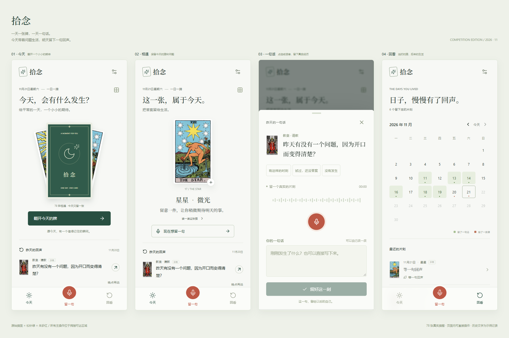

# 每日一牌 · tarot-diary

> 三张看今天，一张看眼下。

一个把「每日记录」的门槛降到一次开口的塔罗日记工具。抽一张牌给你今天的开口，说一句今天发生了什么，第二天抽卡时你会看到昨天那句话。它不预测未来，只是帮你把今天和眼前，都留下来。

## React 工程版

`apps/web` 新增了 React + Vite 工程，围绕「每日一牌 → 次日复盘 → 语音或点选记录 → 日历回看」实现，包含完整 78 张牌、录音原文件保存、可编辑转写、导出、单元测试和浏览器测试。

```bash
npm ci
npm run dev
# http://127.0.0.1:4175

npm run check
```

四屏界面设计：`http://127.0.0.1:4175/design-board.html`。生产构建输出到 `apps/web/dist`。

工程版使用 React 18 + Vite 6、JavaScript / JSX 和 CSS；桌面与手机共用响应式页面。当前没有后端数据库：LocalStorage 保存文字与抽牌，IndexedDB 保存录音，各设备独立保存，尚不支持账号与跨设备同步。

每日抽牌包含洗牌、抽离、翻面与落位动画，可跳过或重播；设置可选完整、柔和或跟随系统，减少动态效果时保留柔和过渡：[查看动效预览与设计](docs/draw-motion.md)。「留一句」支持按住直接录音转写、松开确认、上滑取消：[语音交互设计](docs/voice-ux.md)。



工程结构与扩展边界见 [架构说明](docs/architecture.md)，操作与验证方式见 [工程版说明](apps/web/README.md)。原有根目录单文件版、三张/即时抽卡、牌面和截图继续保留，运行方法如下。

---

## 两种抽法

| | 今日三张 | 问一张 |
|---|---|---|
| 频率 | 每天一次，抽完锁定 | 不限次数 |
| 选牌 | 摊开十张，自己选 3 张 | 摊开十张，自己选 1 张 |
| 语义 | 宏观 · 今天的整体走向 | 微观 · 回应眼前这件小事 |
| 牌位 | 过去 / 现在 / 未来 | 单张关键词 |

抽卡流程：洗牌（牌堆抖动 + 合成音效）→ 十张一字排开、背面朝上、标 1–10 → 自己点选 → 翻开。

## 另外两件事

- **说话** — 三张之后按住说话，说多乱都行，它替你留下一句可编辑的话，并把挑出来的关键词回显出来。
- **回响** — 第二天抽三张时，下方会浮现昨天那句话。

## 运行

```bash
python3 serve.py 8000
# 打开 http://localhost:8000
```

`serve.py` 带 no-cache 响应头，改代码后刷新即生效。

也可以直接双击 `index.html`（单文件零依赖），但浏览器限制下语音不可用，页面会自动降级为「用一段示例」。

## 结构

```
index.html          单文件应用（HTML + CSS + JS，零依赖）
cards/              78 张牌面，00.jpg ~ 77.jpg（360×600，3:5）
serve.py            本地预览服务器（禁缓存 + 补齐 MIME）
shots/              演示截图
```

## 牌库

完整 78 张：22 张大阿卡纳 + 56 张小阿卡纳（权杖 / 圣杯 / 宝剑 / 星币各 14 张）。

| 编号 | 范围 |
|---|---|
| 00–21 | 大阿卡纳（愚人 → 世界） |
| 22–35 | 权杖 |
| 36–49 | 圣杯 |
| 50–63 | 宝剑 |
| 64–77 | 星币 |

没有图片时会自动退化为原创几何符号牌面，不会白屏。

## 技术

- 单文件 HTML，零依赖、零外部请求
- 语音：浏览器原生 Web Speech API（需 https 或 localhost）
- 音效：Web Audio API 实时合成，无音频文件
- 提炼：本地规则引擎（情绪 × 转折 × 行动 × 长度 → 模板池），同一段话结果可复现
- 存储：仅本机 localStorage，不上传任何服务器
- 抽牌：日期 + 模式做种子确定性洗牌，同一天同一组十张，刷新不变

## 数据

```json
{
  "2026-11-21": {
    "macro": { "cards": [59, 49, 15], "refined": "…", "keywords": ["…"] },
    "micro": [ { "card": 40 }, { "card": 53 } ]
  }
}
```

`macro` 每天一条，抽完即锁定；`micro` 可无限追加。说明页底部有「清空本机数据」用于重置。

## 创作说明

界面设计、78 张牌的牌义文案、抽卡与洗牌交互、一句话提炼的规则体系，均在华为云码道（CodeArts）辅助下完成并逐轮修改。

第三方内容：78 张牌面图像由作者提供，仅用于本项目展示。
