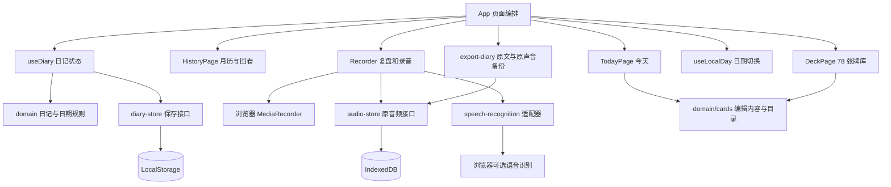

# 拾念工程架构

现有零依赖单文件版保留在根目录。新工程位于 `apps/web`，使用 npm workspace、React 18、Vite 6、Lucide 图标和独立 CSS；Node 内置测试验证业务规则，Playwright 验证真实页面工作流。

## 数据契约

当前没有服务器或云数据库。LocalStorage 保存文字与抽牌，IndexedDB 作为浏览器本地数据库保存原音频；数据按设备与浏览器隔离，没有账号和跨设备同步。电脑与手机使用的是同一个响应式 Web 应用，不是独立的原生 App。

同一天一个记录，可先写日记后抽牌，也可先抽牌后复盘。`cardId` 为 1–78，空值表示独立的一句话；`date` 为本地 `YYYY-MM-DD`；`status` 为 `pending / yes / tried / none / noted`；`text` 保存用户确认后的文字；`audioId` 指向原录音。

`upsertRecord` 保持原日期和 ID，并保护已存在的当日牌。`createReflectionPatch` 允许只点选结果、只写文字或只留音频；没有任何内容时拒绝保存。

存储服务在写入成功后才更新界面状态。读取失败会暴露错误并保留存储中的原值；不会自动用演示数据覆盖。录音导出缺少原文件时明确失败，避免生成看似完整的备份。

## 语音边界

录音状态包括 `idle / requesting / recording / paused / processing / finished`。转写与录音分离：ASR 失败不终止原音频录制；原录音、复盘结果和编辑后的文字分别保存。当前不保留独立的原始 ASR 文本副本。

`HoldToRecordButton` 负责指针捕获与长按/上滑手势，`App` 管理本次手势的可变存活标记与入口来源。`Recorder` 是共用录音/转写/保存控制器：今天使用 `InlineRecorder` 页内视图，历史日期使用原复盘面板。页内实例在松手、回听与编辑之间保留，不创建 Modal。`VoiceWaveform` 通过 Web Audio Analyser 读取当前音频流并绘制 canvas，停止后断开节点并关闭音频上下文。

开始长按时保存草稿快照；取消会递增录音任务版本，忽略旧录音和识别回调，释放麦克风并恢复快照。延迟返回的权限先检查任务版本与手势是否仍按住，避免松开后开始后台录音；结束时等待 ASR 尾句，最多 1.2 秒。文字和音频仍按原数据契约保存，无数据库迁移。

页内控制器通过 ref 提供离页确认、停止和可否开始录音三个命令，状态回调让导航入口同步显示录音状态。未保存离页可继续或放弃；跨午夜保持草稿原日期，保存或放弃后才切换到新一天。新口述追加到现有文字，当前单音频契约保留最新录音；取消新的口述会恢复之前未保存的音频。

## 两端界面

桌面端使用顶部导航、独立录音按钮、牌面与提示并排布局，下方为页内记录，历史页为日历与记录双栏。移动端保留固定底部导航与大录音按钮，兼容安全区；短屏从底部入口按住时让内容滚动到可见处，入口保持固定。`useViewportMetrics` 读取 VisualViewport，键盘出现后固定保存操作，松手不主动聚焦文字。CSS 使用系统字体，详情和录音控制器通过 React.lazy 加载。

共享 Modal 管理焦点、Escape、背景不可操作状态与内部滚动；未保存确认框有单独的键盘焦点范围。牌库标签支持方向键与首尾键，历史搜索支持关键字和已记录/待回看筛选。

下一阶段可用后端转写服务替换浏览器适配器。当前没有实现云端接口、密钥管理、云存储或 AI 提炼；这些能力不会返回模拟成功结果。正式接入时应由后端持有华为云凭据，前端只提交授权后的录音任务，并分别处理上传、处理中、成功、失败和重试。

## 验证与部署

`npm run check` 执行静态检查、单元测试、牌面完整性检查、生产构建；`npm run test:e2e` 验证浏览器流程。设计板随应用一起构建。部署目录为 `apps/web/dist`，应通过 HTTPS 访问录音功能。

GitHub 仓库保留原有提交历史。根目录旧版及其数据结构不受新工程替换；两个版本使用不同数据契约，当前不自动迁移。
