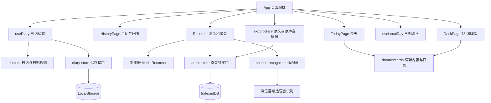

# 拾念工程架构

现有零依赖单文件版保留在根目录。新工程位于 `apps/web`，使用 npm workspace、React 18、Vite 6、Lucide 图标和独立 CSS；Node 内置测试验证业务规则，Playwright 验证真实页面工作流。

## 数据契约

同一天一个记录，可先写日记后抽牌，也可先抽牌后复盘。`cardId` 为 1–78，空值表示独立的一句话；`date` 为本地 `YYYY-MM-DD`；`status` 为 `pending / yes / tried / none / noted`；`text` 保存用户确认后的文字；`audioId` 指向原录音。

`upsertRecord` 保持原日期和 ID，并保护已存在的当日牌。`createReflectionPatch` 允许只点选结果、只写文字或只留音频；没有任何内容时拒绝保存。

存储服务在写入成功后才更新界面状态。读取失败会暴露错误并保留存储中的原值；不会自动用演示数据覆盖。录音导出缺少原文件时明确失败，避免生成看似完整的备份。

## 语音边界

录音状态包括 `idle / requesting / recording / paused / processing / finished`。转写与录音分离：ASR 失败不终止原音频录制；原文、用户选择的复盘结果和编辑后的文字分开保留。

下一阶段可用后端转写服务替换浏览器适配器。当前没有实现云端接口、密钥管理、云存储或 AI 提炼；这些能力不会返回模拟成功结果。正式接入时应由后端持有华为云凭据，前端只提交授权后的录音任务，并分别处理上传、处理中、成功、失败和重试。

## 验证与部署

`npm run check` 执行静态检查、单元测试、牌面完整性检查、生产构建；`npm run test:e2e` 验证浏览器流程。设计板随应用一起构建。部署目录为 `apps/web/dist`，应通过 HTTPS 访问录音功能。

GitCode 仓库保留原有提交历史。根目录旧版及其数据结构不受新工程替换；两个版本使用不同数据契约，当前不自动迁移。
