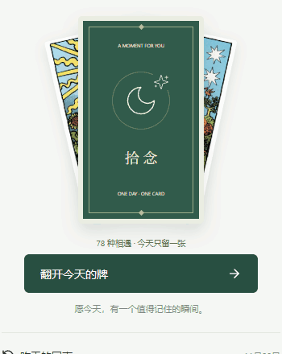

# 每日抽牌动效

轻洗牌、抽离、翻面、落位，最后露出今天的提醒。完整动作约 2 秒；图片准备时间单独处理。保持现有松针绿牌背和原始牌面，不加自动音效。

## 动作节奏

1. **0–480 ms，轻洗牌**：两侧牌错开又收回，顶牌轻微摆动。按钮显示「轻轻洗牌」。
2. **480–1580 ms，抽离与翻面**：顶牌抬起约 30 px，先收窄牌背再展开真实牌面；后方牌堆淡下去，主牌轻轻回落。
3. **1580–2000 ms，落位**：同一张牌平滑移动到今日牌位置；桌面移向左侧，手机略微缩小。牌名、提示和记录入口随后显示。

卡面、牌堆和文字使用 CSS 动画，通过阶段事件推进，并设置有界超时回退，不依赖 Web Animations API。主要变化为 transform 和 opacity。固定牌的宽高比例，浮动层不参与页面排版；动画结束后移除浮动层和临时 GPU 提示。

## 交互边界

- 先保存结果，再开始动画；连续点击、跳过和刷新不会重新抽牌。
- 「跳过」立即进入当天结果；「重播翻牌」只播放已保存的同一张牌，不改写抽牌或日记。
- 设置「抽牌动效」提供跟随系统、完整、柔和，使用 `shinian-motion-v1` 保存偏好。跟随系统且减少动态效果时采用 240 ms 交叉淡入与 160 ms 收尾；选择完整时保留完整动作。跟随系统的过程中打开减少动态效果会结束当前过场。
- 图像解码完成才翻面；加载失败或超时保留已抽到的牌，恢复页面操作并提示稍后查看。
- 导航、打开录音、滚轮或触摸滑动、旋转屏幕或切到后台会结束过场，保持原抽牌结果。浏览器自动滚动定位不会取消动画。
- 读屏在结果展示时能读取牌名和提示；装饰浮动层不会重复朗读。

## 预览与验证

本地体验：`http://127.0.0.1:4175/?preview=home`。该入口使用内存示例状态，刷新可重看，不改写正式文字记录。GIF 用固定「星星」牌演示，正式应用仍按当天首次抽取结果保存。

浏览器测试覆盖动画阶段、真实牌图解码、结果一致性、连续点击、跳过、刷新、页面切换、录音入口、减少动态效果和图片失败。桌面 1440 px 与手机 390 px 的翻面和落位另经截图检查。

2026-11-22 修复：用户实际 Edge 页面报告系统减少动态效果，旧逻辑因此直接跳过。新增柔和模式、完整模式覆盖和重播入口；测试同时移除 `Element.prototype.animate`，确认 CSS 动画仍可播放。当前完整模式截图为 `mobile-full-motion.png`。
