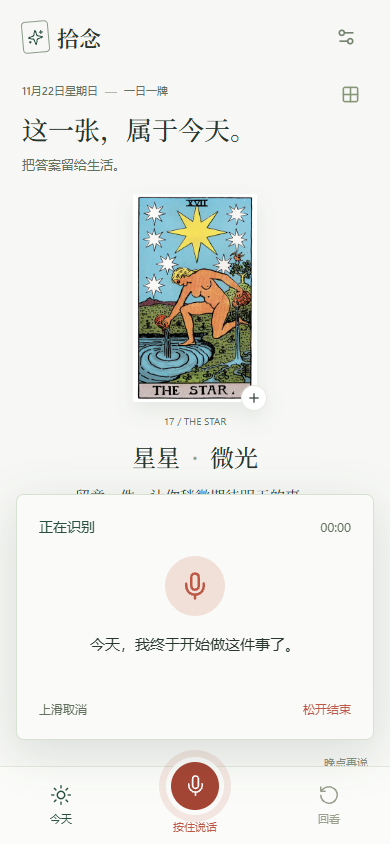
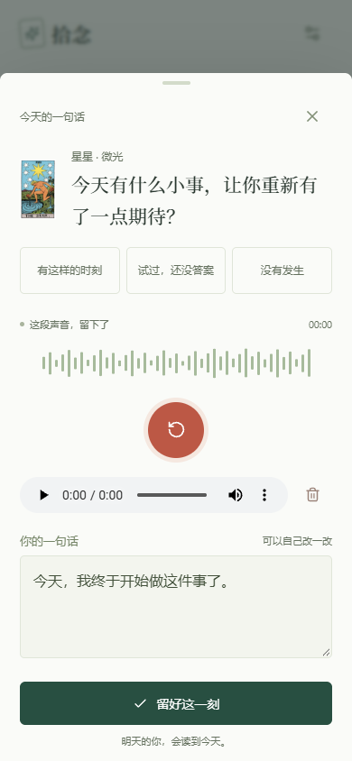
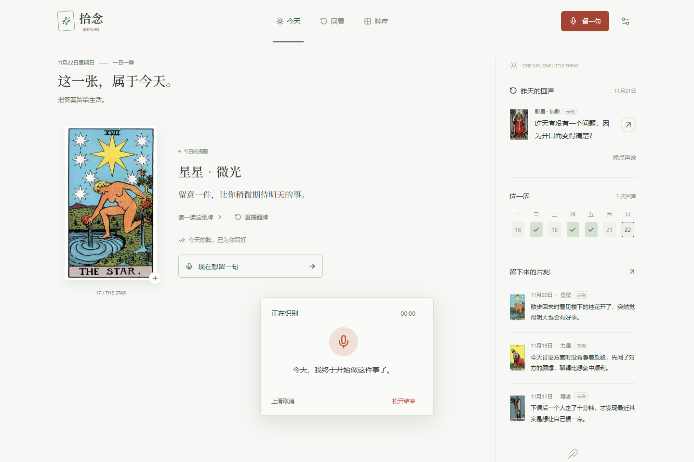

# 一次长按，留下一句话

桌面顶部「留一句」、今日牌下的记录入口、手机底部麦克风使用同一个手势。按钮固定尺寸，按住时颜色改变；手机入口直接标注「按住说话」。

1. 按住 200 ms：打开录音浮层，直接请求麦克风并启动录音、中文识别，无需再点麦克风。浮层显示计时、正在录音/识别状态和实时转写。
2. 松开：停止录音，等待识别尾句后进入可回听、可修改的确认页。点击「留好这一刻」才写入日记；新口述追加到原有文字后。
3. 上滑超过 72 px：浮层变为取消状态；移回继续，松开取消。本次草稿和录音不保存，原记录不变。
4. 短按或键盘 Enter：打开完整编辑器，保留文字输入和键盘使用路径。

## 权限与中断

- 首次使用需要浏览器允许麦克风。如果授权弹窗使手势中断，允许后再次按住即可；松开后才返回的权限不会启动录音。
- 指针取消、窗口失焦、切到后台时取消本次长按并释放麦克风。
- 识别服务不可用时仍保存原录音，并明确提示可以补写文字；不填充模拟转写。
- 语音识别可能使用浏览器厂商在线服务。当前尚未接入华为云 ASR，不承诺真人识别准确率。

## 界面截图

截图使用测试麦克风和模拟中文识别回调，展示反馈和布局，不代表识别准确率测试。

