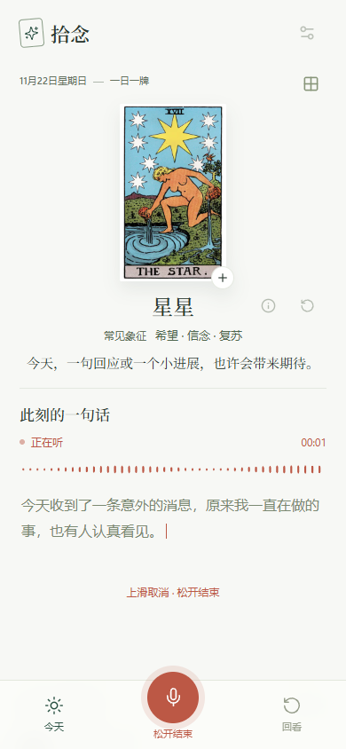
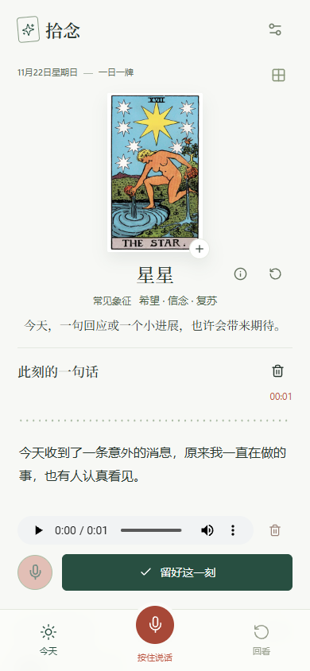
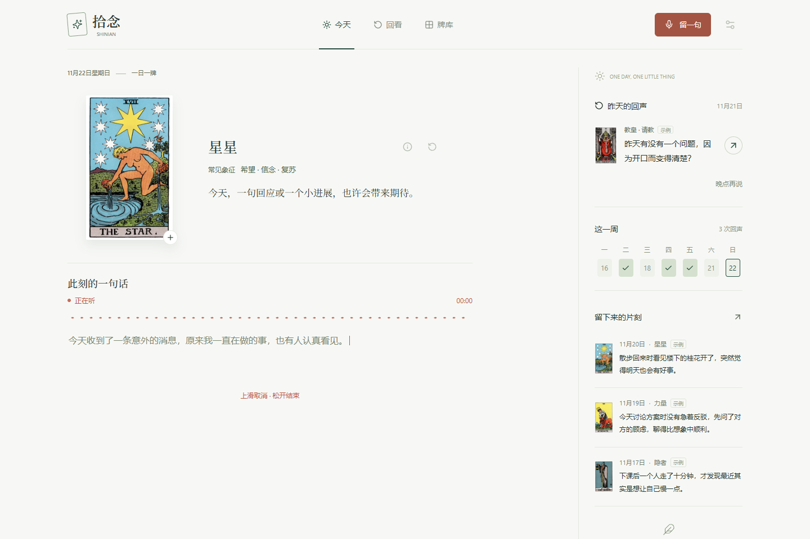

# 页内说话，原地留下一句

桌面顶部「留一句」、页内麦克风和手机底部麦克风使用同一个手势。「今天」的卡片与描述保留在上方，语音与文字直接进入下方「此刻的一句话」，没有录音弹层或遮罩。保留用户原有 78 张牌面素材。

1. 按住 200 ms：直接启动录音与中文识别，原地显示计时、音量波形与实时文字；转写区域保持高度，长内容内部滚动。
2. 松开：等待识别尾句后，在同一区域回听、编辑、保存。不会自动聚焦或弹键盘；点击「留好这一刻」才写入日记。
3. 上滑超过 72 px：显示取消状态；移回继续，松开取消。恢复口述前的文字、音频与计时，已有记录不变。
4. 短按顶部或底部入口：聚焦页内文字。页内麦克风支持键盘/单击开始与结束录音，并可暂停和继续。

波形读取实际音频采样；安静时保持低幅，不用随机动画冒充声音变化。录音入口保持位置，短屏从底部入口发起时只滚动上方内容，避免文字被导航挡住。移动端键盘出现后，保存按钮位于键盘上方。

新口述追加文字，当前单音频记录保留最新一次声音。再次录制后取消，会恢复此前未保存的声音；保存失败保留文字与音频草稿。未保存离页可选择继续或放弃；跨午夜草稿保存到开始记录的日期。昨天及历史复盘保留原独立面板。

## 权限与中断

- 首次使用需要浏览器允许麦克风。如果授权弹窗使手势中断，允许后再次按住即可；松开后才返回的权限不会启动录音。
- 指针取消、窗口失焦、切到后台时取消本次长按并释放麦克风。
- 识别服务不可用时仍保存原录音，并明确提示可以补写文字；不填充模拟转写。
- 语音识别可能使用浏览器厂商在线服务。当前尚未接入华为云 ASR，不承诺真人识别准确率。

## 界面截图

截图使用测试麦克风和模拟中文识别回调，展示反馈和布局，不代表识别准确率测试。

